# Capa Media Ops — Guía de usuario

> Versión 0.1 · noviembre 2026 · Escrita para que cualquier persona del equipo pueda usar la plataforma sin conocerla antes.
> Las pantallas de esta guía se tomaron en **modo simulación**. Los datos que se ven son de ejemplo.

---

## Índice

1. [¿Qué es y para qué sirve?](#1-qué-es-y-para-qué-sirve)
2. [Alcance: qué hace y qué NO hace](#2-alcance-qué-hace-y-qué-no-hace)
3. [Cómo funciona (explicado fácil)](#3-cómo-funciona-explicado-fácil)
4. [Cómo se conecta y autentica con los servidores](#4-cómo-se-conecta-y-autentica-con-los-servidores)
5. [Cómo ingresar a la plataforma](#5-cómo-ingresar-a-la-plataforma)
6. [Roles: quién puede hacer qué](#6-roles-quién-puede-hacer-qué)
7. [Recorrido por las pantallas](#7-recorrido-por-las-pantallas)
8. [Cómo se registran las claves](#8-cómo-se-registran-las-claves)
9. [Qué registra la plataforma y cómo consultarlo](#9-qué-registra-la-plataforma-y-cómo-consultarlo)
10. [Vulnerabilidades y riesgos conocidos](#10-vulnerabilidades-y-riesgos-conocidos)
11. [Siguientes pasos](#11-siguientes-pasos)
12. [Preguntas frecuentes y solución de problemas](#12-preguntas-frecuentes-y-solución-de-problemas)
13. [Glosario](#13-glosario)

---

## 1. ¿Qué es y para qué sirve?

**Capa Media Ops** es una página web interna. Desde ella se ejecutan las tareas que hoy cada persona corre a mano desde su máquina, entrando servidor por servidor:

| Antes (manual) | Ahora (Capa Media Ops) |
|---|---|
| Copiar scripts a cada servidor y editarlos | Los scripts se envían solos y siempre en la versión correcta |
| Cada quien con su usuario y sus claves en archivos | Accesos por llave SSH; claves de WebLogic solo cifradas en el servidor |
| No se sabe quién hizo qué ni cuándo | Cada acción queda registrada con usuario, fecha, parámetros y salida completa |
| Para bajar o subir dominios hay que conocer el orden | La plataforma aplica el orden correcto y toma un snapshot antes de bajar |

**Ejemplo:** para bajar los dominios de DESA en WLPC02SBCC04, usted elige el servidor, marca los dominios y pulsa **Bajar**. La plataforma hace el resto y guarda la evidencia.

---

## 2. Alcance: qué hace y qué NO hace

### ✅ Dentro del alcance (lo que hace hoy)

| Módulo | Qué hace | ¿Modifica algo? |
|---|---|---|
| **Inventario y recolección** | Lista los 182 servidores de la línea base. Recolecta por SSH: SO, CPU, memoria, discos, límites, Java, dominios WebLogic y su dueño. | No, solo lectura |
| **Orquestación WebLogic** | Consulta el estado, verifica credenciales, toma snapshot y baja/sube dominios en orden (Managed Servers vía Node Manager y AdminServer). Hoy: WLPC02SBCC04, 8 dominios, 29 Managed Servers. | Sí, en Bajar, Subir, Snapshot y Credenciales |
| **Usuarios WebLogic** | Lista usuarios del realm. Crea, elimina, da rol de administrador o agrega a grupos vía WLST. Hoy: ATGCPROD. | Sí, en Preparar y Aplicar acciones |
| **Forms: frmweb huérfanos** | Detecta procesos `frmweb` en bucle sin sesión y los termina por lotes. Hoy: AP17SBCC04. | Validar no; Mitigar sí |
| **Ejecuciones y auditoría** | Historial de todo lo ejecutado, salida completa y descarga de evidencia. | No |

### ❌ Fuera del alcance (este proyecto NO lo hace)

- **Comparativo PROD vs DRP** de capa_media. Se descartó; de esa iniciativa solo se conservó la recolección de información de servidores.
- **Despliegue de aplicaciones** (.ear/.war), parches de WebLogic u Oracle, ni cambios de configuración de dominios (datasources, JVM, puertos).
- **Instalar software** en los servidores. Solo usa lo que ya existe: bash, ssh, sudo y WLST.
- **Monitoreo continuo o alertas.** Solo consulta cuando alguien lo pide; no reemplaza a la herramienta de monitoreo.
- **Gestión de usuarios del sistema operativo**, de llaves SSH o de reglas sudoers. Eso lo hace infraestructura.
- **Corregir la causa raíz de frmweb.** La mitigación es temporal; la solución sigue pendiente (FORMS_TIMEOUT y el módulo MIG de TRON).
- **Ansible.** No está autorizado. La plataforma funciona sin él.
- **Integración con LDAP/Directorio Activo, doble factor (MFA) o gestor de cambios (CAB).** El número de cambio se digita a mano.
- **Alta disponibilidad.** Es una sola instancia. Si el equipo donde corre se apaga, la plataforma no está disponible; los servidores siguen funcionando normalmente.

---

## 3. Cómo funciona (explicado fácil)

Piense en la plataforma como un **mensajero de confianza**:

1. Usted pide algo en la página, por ejemplo "consultar estado".
2. La plataforma revisa si **usted tiene permiso** para eso y en ese ambiente.
3. Si es un cambio, le muestra **exactamente qué va a hacer** y le pide confirmar. En PROD/DRP pide además el número de cambio.
4. Entra al servidor por **SSH con su llave**, se convierte en el **usuario dueño de WebLogic** (`sudo`), copia el script si hace falta y lo ejecuta.
5. Usted ve la salida **en vivo**.
6. Al terminar, guarda **toda la evidencia**.

```
 Usted (navegador)                    Nodo central (Capa Media Ops)                 Servidor WebLogic
 ─────────────────                    ─────────────────────────────                 ─────────────────
 1. Pide la acción  ──HTTPS/HTTP──▶   2. Valida rol, ambiente y cambio
                                      3. Muestra vista previa ◀── usted confirma
                                      4. ssh -i llave usuario_ssh@IP  ──SSH (cifrado)──▶  sudo -n -u wlogic14c
                                                                                          bash script (wl-services.sh,
                                                                                          WLST, etc.)
 5. Ve la salida en vivo  ◀──────────  recibe línea a línea  ◀───────────────────────────  salida
                                      6. Guarda evidencia + auditoría
```

**Puntos clave:**
- En los servidores **no se instala nada** y no queda ningún agente corriendo.
- Los scripts viajan empaquetados y se reemplazan solo si cambiaron. El archivo `.cmops_version` indica qué versión hay en el servidor.
- El archivo `wl-config.sh` de cada servidor **se genera** desde el inventario central. Nadie lo edita a mano en el servidor.
- Existe un **modo simulación** para practicar: todo se ve igual, pero no se conecta a ningún servidor. Se reconoce por la etiqueta amarilla **SIMULACION** arriba a la izquierda.

---

## 4. Cómo se conecta y autentica con los servidores

### 4.1 Método de autenticación

| Pregunta | Respuesta |
|---|---|
| ¿Con qué protocolo se conecta? | **SSH**, puerto 22 (o el que diga el inventario). Todo el tráfico va cifrado. |
| ¿Usa usuario y clave? | **No.** Usa **llave SSH** (ed25519). Las claves `SSH_PASS_*` del `.env` antiguo se ignoran a propósito. |
| ¿Con qué usuario entra? | El **usuario SSH de cada servidor** (`ssh_usuario`, tomado de `SSH_USER_<HOST>`). Si un servidor no tiene uno propio, usa la cuenta de servicio global (`svc_capamedia`). |
| ¿Cómo sabe que el servidor es el verdadero? | Verifica la **huella del servidor** (`known_hosts`, StrictHostKeyChecking=yes). Si la huella cambia, se niega a conectar. |
| ¿Cómo llega a ser `wlogic14c` o `wlogic12c`? | Con **`sudo -n -u <usuario_so>`**, sin clave, según una regla sudoers que define infraestructura. El `-n` hace que, si falta la regla, falle de inmediato en lugar de quedarse esperando una clave. |
| ¿Puede quedarse colgada esperando algo? | No. Usa `BatchMode=yes` (nunca pregunta nada) y tiene tiempos máximos por paso. |

### 4.2 Los tres niveles de usuario (ninguno está fijo en el código)

Un mismo servidor puede tener varias instalaciones de WebLogic con dueños distintos. Por ejemplo, WLPC02SBCC04 tiene **wlogic14c** y **wlogic12c**. Por eso la plataforma separa:

| Nivel | Ejemplo | Dónde se define | Cómo se comprueba |
|---|---|---|---|
| **1. Usuario SSH** (entrar al servidor) | `oracle`, `svc_capamedia` | Inventario, por servidor | Botón **Probar conexión** |
| **2. Usuario de SO** (dueño de WebLogic) | `wlogic14c`, `wlogic12c` | Inventario, por **instalación** | **Verificar credenciales** compara con el dueño real de la carpeta del dominio. Si no coincide, la plataforma **se niega a operar**. |
| **3. Credenciales WebLogic** (Node Manager y consola) | usuario NM de `externosdesa` | Se digitan en la página, por **dominio** | **Verificar credenciales** muestra OK / FALTA |

### 4.3 Forma de conexión (red)

- **Usted → plataforma:** navegador a `http://127.0.0.1:8080`. Por defecto solo se abre desde el mismo equipo. Para compartirla con el equipo se configura HTTPS (ver sección 10).
- **Plataforma → servidores:** SSH saliente al puerto 22 de cada servidor. Requiere que el firewall permita esa conexión desde el equipo donde corre.
- **En el servidor:** los scripts hablan con el Node Manager y el AdminServer **locales** (por ejemplo `t3s://10.7.8.19:3061`), igual que cuando se ejecutaban a mano.

---

## 5. Cómo ingresar a la plataforma

### 5.1 Arrancarla

Si nadie la tiene corriendo, se arranca desde una ventana de PowerShell en la carpeta `capa-media-ops`:

```powershell
python bin\cm web
```

Deje esa ventana abierta; si la cierra, la plataforma se detiene. La instalación desde cero en Windows está en [GUIA_WINDOWS.md](GUIA_WINDOWS.md).

### 5.2 Iniciar sesión

1. Abra el navegador en **http://127.0.0.1:8080**.
2. Escriba su **Usuario** y **Clave** de la plataforma. No son su usuario de red ni el de los servidores; los crea el administrador de la plataforma.
3. Pulse **Ingresar**.

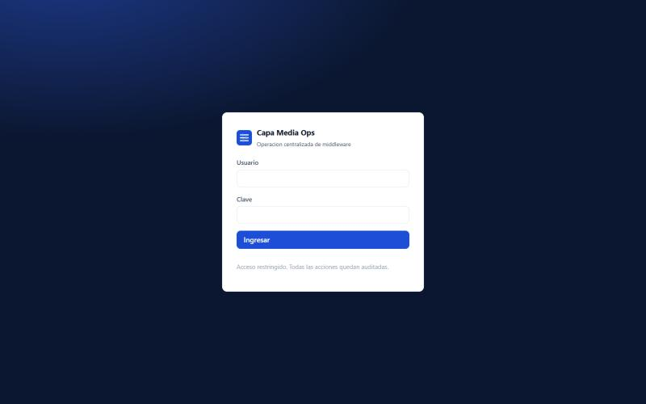

| Regla | Detalle |
|---|---|
| Intentos fallidos | Con **5 intentos fallidos en 15 minutos**, el usuario queda bloqueado temporalmente. Todo intento queda en la auditoría. |
| Duración de la sesión | **30 minutos sin actividad** y la sesión se cierra sola. |
| Cerrar sesión | Botón **Salir**, arriba a la derecha. Hágalo siempre al terminar. |
| Clave | Mínimo 10 caracteres. Se guarda como hash irreversible (PBKDF2-SHA256, 200.000 iteraciones), nunca en texto plano. |

### 5.3 ¿Cómo obtengo un usuario?

Lo crea el administrador desde la consola del equipo donde corre la plataforma:

```powershell
python bin\cm usuario-app crear juan.perez --rol operador
```

La clave se escribe de forma oculta (no se ve al teclear). Por ahora no hay pantalla para crear usuarios; la sección **Administración** solo los lista.

---

## 6. Roles: quién puede hacer qué

| Rol | Puede | No puede |
|---|---|---|
| **consulta** | Ver todo y ejecutar acciones de **solo lectura**: estado, listados, validar, recolectar, probar conexión | Ningún cambio |
| **operador** | Lo anterior + **cambios en ambientes NO productivos** (DESA, PRUEBAS, STAGE) | Cambios en PROD/DRP; ver la auditoría |
| **admin** | **Todo**, incluido PROD/DRP | Hacer cambios en PROD/DRP sin número de cambio (CAB/RFC), que es **obligatorio** |

Reglas adicionales:
- Un servidor que no esté en el inventario se trata como **productivo**, por seguridad.
- **Solo un cambio a la vez por servidor.** Si alguien está bajando dominios en WLPC02SBCC04, otro usuario no puede lanzar otro cambio ahí hasta que termine.
- Las etiquetas rojas **PROD** recuerdan en cada pantalla que se está tocando producción.

---

## 7. Recorrido por las pantallas

### 7.1 Panel

Es la primera pantalla después de ingresar. Muestra:
- Cuántos servidores hay en el inventario.
- Cuántos dominios están orquestados.
- Las ejecuciones de hoy y cuántas fallaron.
- Las últimas ejecuciones.
- Los servidores por ambiente.

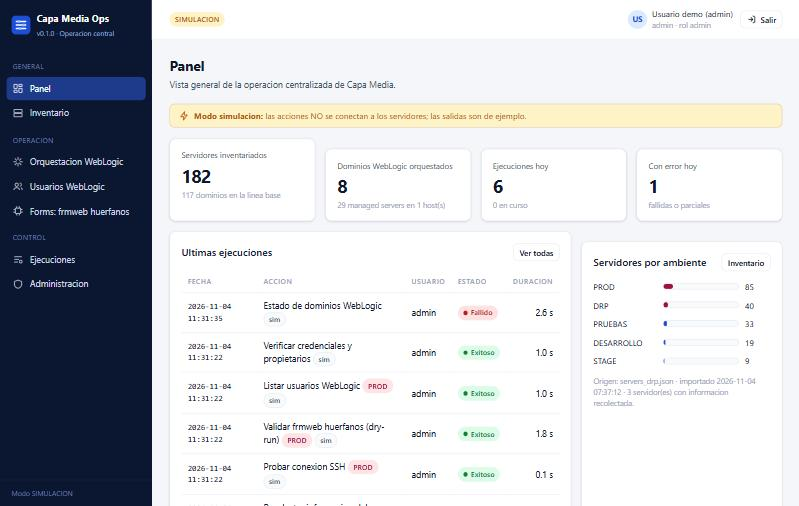

> El estado **Fallido** de la primera fila es real y esperado: se consultó el estado de dominios que todavía no tienen credenciales registradas (ver sección 8).

### 7.2 Inventario

Lista de los 182 servidores con su IP, ambiente y dominios. Puede **buscar** por hostname, IP o dominio y **filtrar** por ambiente o módulo.

Para ejecutar sobre varios servidores a la vez, márquelos y use **Probar conexión** o **Recolectar información**. Ambas son de solo lectura.

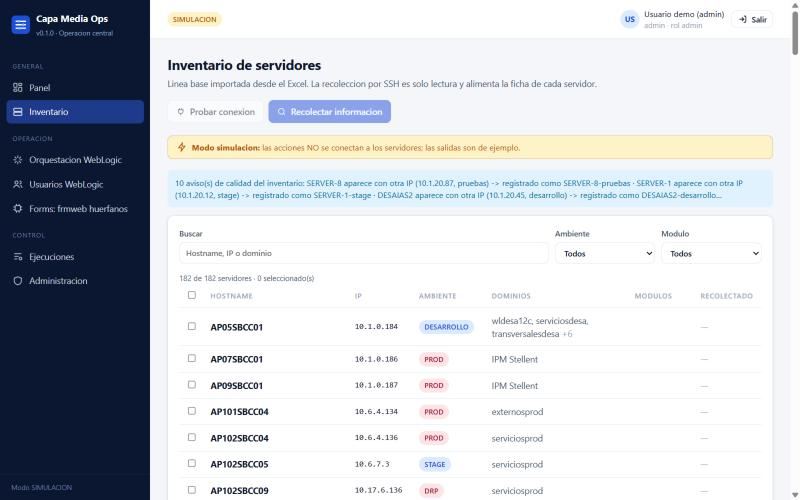

Al hacer clic en un servidor se abre su **ficha**, con:
- Los datos de conexión, incluido el **usuario SSH** que usará.
- La **información recolectada**: SO, kernel, CPU, memoria, Java, dominios WebLogic **con su dueño** y discos.

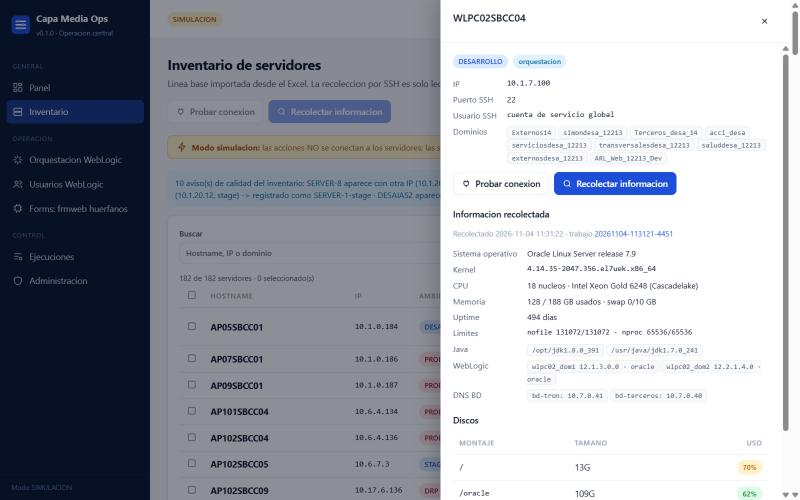

**Para obtener la información de un servidor:**
1. Abra su ficha.
2. Pulse **Recolectar información** y confirme.
3. Espere unos segundos. La ficha se llena y la información queda guardada (ver sección 9).

### 7.3 Orquestación WebLogic

1. Elija el **servidor**, por ejemplo WLPC02SBCC04.
2. Elija la **instalación**, por ejemplo `wlogic14c`. Cada instalación muestra su usuario de SO.
3. En la tarjeta **Acciones** verá con qué usuario SSH y con qué usuario de SO se ejecutará.

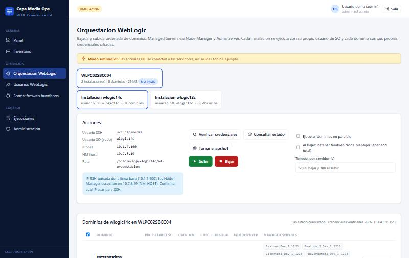

En la tabla de dominios, cada fila muestra:
- **Propietario SO**: verde si coincide con la instalación, rojo si no coincide.
- **Cred. NM / Cred. consola**: OK o FALTA.
- **AdminServer**: su estado.
- **Managed Servers**: cada uno con un color según su estado (verde RUNNING, rojo caído).

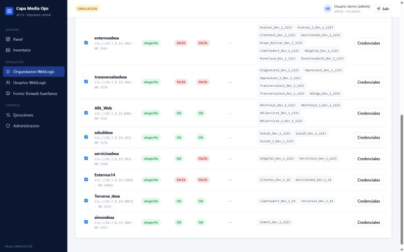

| Botón | Qué hace | ¿Cambia algo? |
|---|---|---|
| **Verificar credenciales** | Revisa dueño del dominio y si existen las credenciales cifradas | No |
| **Consultar estado** | Estado del AdminServer y de cada Managed Server | No |
| **Tomar snapshot** | Guarda en el servidor qué Managed Servers están arriba | Escribe un archivo de estado |
| **Bajar** | Toma un snapshot automático, baja los Managed Servers (Node Manager) y luego el AdminServer | **Sí** |
| **Subir** | Sube el AdminServer y luego **solo** los Managed Servers del snapshot | **Sí** |
| **Credenciales** (en cada fila) | Registra usuario/clave de Node Manager y consola de ese dominio | **Sí** (crea archivos cifrados) |

Opciones adicionales:
- **Paralelo**: procesa varios dominios a la vez. Es más rápido, pero hay más carga en el servidor.
- **Detener también Node Manager**: para un apagado total.
- **Timeout**: segundos de espera por servidor.

**Antes de un cambio siempre aparece la confirmación.** Muestra los pasos exactos y el campo del número de cambio. Hay que marcar la casilla "Confirmo que revisé la lista":

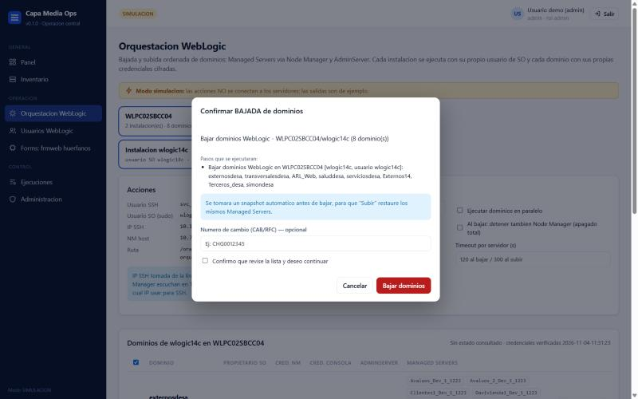

> **Flujo recomendado:**
> 1. Verificar credenciales.
> 2. Consultar estado.
> 3. Bajar.
> 4. Subir.
> 5. Consultar estado otra vez y comparar.
>
> Si un dominio no tiene credenciales o su dueño no coincide, Bajar y Subir **se detienen antes de tocar nada**.

### 7.4 Usuarios WebLogic

1. Elija el dominio (hoy ATGCPROD).
2. **Preparar dominio**: se hace una sola vez. Pide el usuario y la clave de administrador de consola, extrae el certificado y genera las credenciales cifradas.
3. **Listar usuarios** para ver el realm.
4. En **Acciones a aplicar**, agregue filas:
   - **CREAR**: necesita clave de 8 o más caracteres, distinta del usuario.
   - **ELIMINAR**: no permite eliminar `weblogic`.
   - **ADMIN**: da rol de administrador.
   - **GRUPO**: agrega a un grupo.
5. Pulse **Aplicar acciones**.

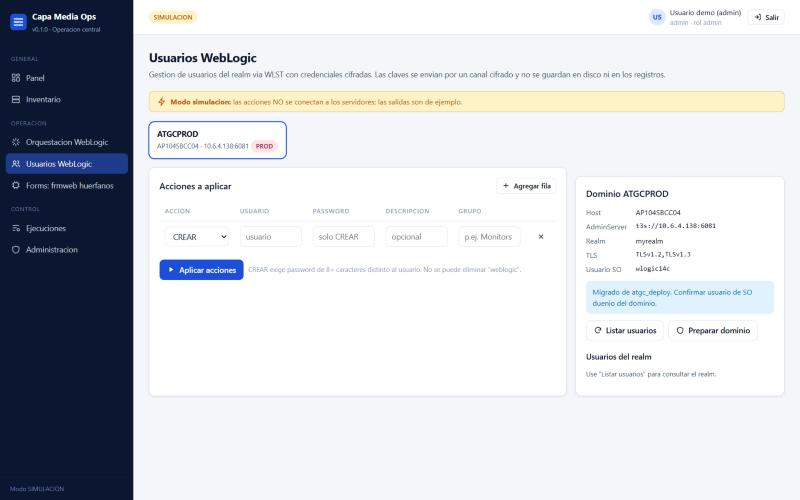

### 7.5 Forms: frmweb huérfanos

1. **Validar (dry-run)**: cuenta los procesos huérfanos por Managed Server **sin terminar ninguno**.
2. **Mitigar**: los termina por lotes con pausas.
   - Solo termina procesos en estado R (en ejecución) **y** sin conexiones activas.
   - Al final hace un barrido de seguridad.

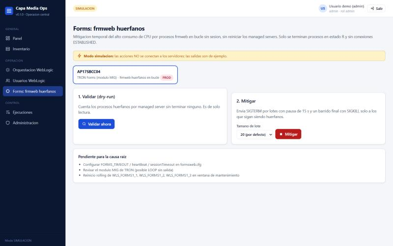

### 7.6 Ejecuciones

Historial de **todo** lo que se ha hecho en la plataforma. Se puede filtrar por estado, módulo o "solo mis ejecuciones".

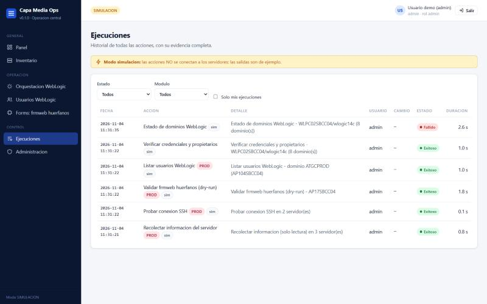

Al abrir una ejecución se ve:
- La **salida completa**, en vivo si todavía está corriendo.
- Quién la lanzó, cuándo, con qué número de cambio, cuánto duró y los parámetros usados.
- **Descargar log**: baja el archivo de evidencia.
- **Cancelar**: disponible mientras la ejecución está corriendo.

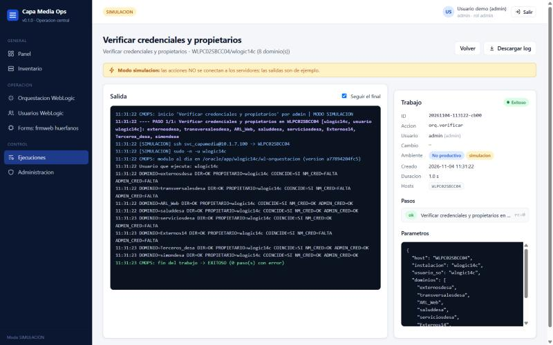

### 7.7 Administración (solo rol admin)

- Usuarios de la plataforma y sus roles.
- **Recargar inventario**: aplica cambios hechos en los archivos del inventario sin reiniciar.
- **Auditoría**: los últimos eventos (ingresos, ejecuciones creadas, finalizadas y canceladas).

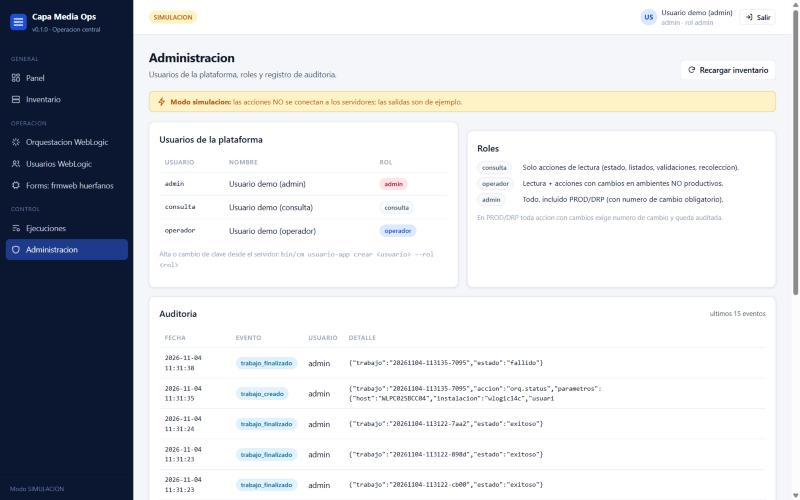

---

## 8. Cómo se registran las claves

Hay **cuatro tipos** de clave, y cada una se maneja distinto:

| Clave | ¿Dónde se escribe? | ¿Dónde queda guardada? | ¿Queda en logs? |
|---|---|---|---|
| **Su clave de la plataforma** | Al crear su usuario (consola) y al ingresar | Solo como hash irreversible en `config/usuarios_app.json` | No |
| **Llave SSH** del nodo central | Se crea una vez (`ssh-keygen`) | Llave privada en el equipo central (solo lectura para su dueño); la pública en cada servidor | No aplica |
| **Credenciales de Node Manager y consola** de cada dominio | Página **Orquestación → Credenciales** | **Solo en el servidor**, cifradas por WebLogic: `<dominio>/nmsecure/*.secure`, permisos 600 | **No.** Solo se registra el *usuario*, nunca la clave |
| **Clave admin de consola** para Usuarios WL, y claves de usuarios nuevos | **Usuarios WebLogic → Preparar / Aplicar** | En el servidor, cifradas (`.wl_userconfig`). Las claves de usuarios nuevos no se guardan. | No; aparecen como `********` |

### Paso a paso: registrar las credenciales de un dominio

1. Vaya a **Orquestación WebLogic** y elija el servidor y la instalación.
2. Pulse **Verificar credenciales**. Los dominios con **FALTA** son los que necesitan registro.
3. En la fila del dominio, pulse **Credenciales**.
4. Escriba:
   - **Usuario Node Manager** y **Clave Node Manager** (obligatorios).
   - **Usuario consola** y **Clave consola** (opcionales). Si los deja vacíos, la consulta de estado usará el Node Manager.

   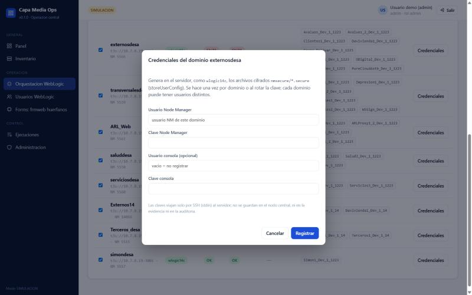
5. Pulse **Registrar**, revise la confirmación y confirme.
6. En la salida debe aparecer `CRED_OK nm` (y `CRED_OK admin`, si registró la de consola).
   - Si aparece `CRED_ERROR`, el usuario o la clave son incorrectos y **no se guardó nada**.
7. Pulse **Verificar credenciales** otra vez: el dominio debe mostrar **OK**.

**¿Por qué así?**
- Cada dominio puede tener usuarios distintos, así que no se asume `weblogic` en ninguno.
- La clave viaja por el canal SSH cifrado directamente al script, como entrada estándar.
- En el servidor, WebLogic la cifra con su propio mecanismo (`storeUserConfig`), el mismo que usaban los scripts originales.
- El nodo central **nunca** la guarda.

**¿Cuándo repetirlo?** Solo cuando cambie la clave de Node Manager o de consola de ese dominio (rotación).

---

## 9. Qué registra la plataforma y cómo consultarlo

### 9.1 Qué se guarda

| Registro | Dónde | Qué contiene | Cómo verlo |
|---|---|---|---|
| **Evidencia de cada ejecución** | `evidencias/trabajos/<id>.log` | La salida completa línea a línea, con hora | **Ejecuciones → abrir → Descargar log** |
| **Ficha de cada ejecución** | `evidencias/trabajos/<id>.json` | Quién, rol, acción, servidores, parámetros (sin claves), número de cambio, ambiente, estado, inicio, fin, duración, resultado de cada paso | **Ejecuciones → abrir** (panel derecho) |
| **Auditoría** | `evidencias/auditoria.jsonl` (una línea por evento) | Ingresos exitosos y fallidos (con IP), bloqueos, salidas, trabajos creados, finalizados y cancelados, recarga de inventario | **Administración → Auditoría** |
| **Información de servidores** | `inventario/hechos/<HOST>.json` | Lo recolectado: SO, kernel, CPU, RAM, swap, uptime, discos, límites, Java, dominios WebLogic (versión, dueño, Managed Servers, despliegues, datasources) y resolución DNS de las BD | **Inventario → ficha del servidor** |
| **Snapshot de Managed Servers** | **En el servidor:** `<ruta>/state/<dominio>.snapshot` | Qué Managed Servers estaban RUNNING en ese momento | Su contenido aparece en la salida de la ejecución de snapshot o de bajada |

> **Nunca se registran:** claves de WebLogic, claves de usuarios nuevos ni su clave de la plataforma. Esto se comprobó buscando una clave de prueba en todas las carpetas de evidencia, inventario y configuración: no apareció.

### 9.2 ¿Se puede sacar la información? (por ejemplo, la de un snapshot o una recolección)

**Sí.** Todo queda en archivos de texto (JSON o log) dentro de la carpeta de la plataforma, y se puede abrir con el Bloc de notas, Excel o cualquier herramienta.

- **Desde la página:**
  - **Descargar log** de cualquier ejecución, para adjuntarlo a un cambio o a un incidente.
  - La **ficha del servidor** muestra lo recolectado.
- **Desde la carpeta:**
  - `inventario/hechos/` tiene un JSON por servidor, útil para armar un reporte o compararlo con la línea base.
  - `evidencias/trabajos/` tiene todos los logs y fichas.
- **Snapshot:** queda en el servidor, en `state/<dominio>.snapshot`, y la plataforma lo usa automáticamente al **Subir**. Para ver qué contiene, abra la ejecución de **Tomar snapshot** o de **Bajar**: la salida indica cuántos y cuáles Managed Servers se guardaron.
- **Capturas de pantalla:** las de esta guía están en `docs/img/` y pueden reutilizarse en presentaciones.

> Mejora sugerida (aún no existe): un botón **Exportar a Excel** del inventario recolectado, y una vista del contenido del snapshot dentro de la página.

---

## 10. Vulnerabilidades y riesgos conocidos

Se listan con honestidad para que seguridad e infraestructura decidan. La severidad es una estimación del equipo.

| # | Riesgo | Severidad | Por qué | Mitigación actual | Qué falta |
|---|---|---|---|---|---|
| 1 | **El nodo central es un objetivo valioso** | Alta | Quien controle el equipo central y su llave SSH puede entrar a los servidores y hacer `sudo` a los usuarios de WebLogic | Llave dedicada, acceso solo con usuario de la plataforma, auditoría | Servidor dedicado y endurecido (no un PC personal), llave con frase en un agente, acceso restringido por red |
| 2 | **Regla sudoers amplia** (`NOPASSWD: /bin/bash` hacia wlogic*) | Alta | Permite cualquier comando como el usuario de WebLogic, no solo los scripts | Limitada a los usuarios de WebLogic, nunca a root | Restringirla a los scripts de la plataforma cuando esté estable |
| 3 | **HTTP sin cifrar** si se abre a la red | Media | Por defecto solo escucha en 127.0.0.1, pero si se abre al equipo sin TLS, claves y sesión viajarían en claro por la red | Por defecto solo local. La cookie pasa a "Secure" al activar TLS. | Certificado TLS antes de compartirla |
| 4 | **Sin doble factor ni Directorio Activo** | Media | Una clave robada de la plataforma basta para entrar | Bloqueo tras 5 intentos, claves con hash fuerte, sesión de 30 min | Integrar LDAP/AD y MFA |
| 5 | **Auditoría y evidencia en archivos locales** | Media | Alguien con acceso al equipo podría borrarlas o alterarlas | Solo se agregan líneas; quedan en la carpeta de la plataforma | Copia diaria a un repositorio central o a un SIEM |
| 6 | **Credenciales cifradas de WebLogic en el servidor** | Media | Los archivos `.secure` los puede usar cualquiera que ya sea el usuario dueño del dominio en ese servidor. Es el mismo mecanismo del proceso manual. | Permisos 600, carpeta del dominio | Rotación periódica de claves NM y consola |
| 7 | **Usuarios demo** (`CREDENCIALES_DEMO.txt`) | Alta si se olvida | Tienen claves conocidas | Solo se pueden crear en modo simulación | **Borrarlos** antes de pasar a modo real (checklist en GUIA_WINDOWS, paso 9) |
| 8 | **La salida de los comandos queda en la evidencia** | Baja | Si un script imprime datos sensibles, quedan en el log | Los scripts no imprimen claves | Revisar periódicamente los logs |
| 9 | **Una sola instancia** | Baja | Si el equipo cae, no hay plataforma (los servidores no se afectan) | Los scripts siguen pudiendo ejecutarse a mano | Instancia de respaldo |
| 10 | **Hallazgos heredados de los scripts originales** | Alta | `usuarios_weblogic.txt` tenía claves en texto plano y se creó `dbap_prueba` con clave igual al usuario en Administrators (ATGCPROD) | La plataforma ya no usa ese archivo | **Verificar y eliminar `dbap_prueba`** y borrar el archivo con claves |
| 11 | **Desactivar la verificación de huella** (`verificar_host: false`) | Media | Permitiría conectarse a un servidor suplantado | Activa por defecto | No desactivarla nunca en modo real |

**Controles que ya existen:**
- Roles por ambiente y número de cambio obligatorio en PROD/DRP.
- Confirmación explícita antes de cada cambio.
- Un cambio a la vez por servidor.
- Protección CSRF y política de contenido estricta (CSP) en la página.
- Validación de todo lo que se escribe, para impedir inyección de comandos (por ejemplo, en nombres de dominio).
- Claves solo por canal cifrado.
- Verificación del dueño del dominio antes de operar.

---

## 11. Siguientes pasos

| # | Paso | Responsable sugerido | Bloquea la prueba real |
|---|---|---|---|
| 1 | Definir **dónde vivirá** la plataforma (servidor dedicado o, para el piloto, un PC Windows) | Líder técnico + infraestructura | Sí |
| 2 | Crear la **cuenta SSH y la llave**; instalar la llave pública en los servidores del piloto | Infraestructura | Sí |
| 3 | Crear la **regla sudoers** hacia `wlogic12c` / `wlogic14c` | Infraestructura | Sí |
| 4 | Abrir **firewall** desde el nodo central al puerto 22 | Redes | Sí |
| 5 | Confirmar la **tabla de usuarios** (IP SSH de WLPC02SBCC04, usuario SSH por servidor, dueño de ATGCPROD, usuarios NM y consola por dominio) | Equipo de middleware | Sí |
| 6 | Importar el **`.env` real** de usuarios SSH (`bin/cm importar-usuarios-ssh`) | Equipo de middleware | Sí |
| 7 | Crear usuarios reales de la plataforma y **borrar los demo** | Administrador de la plataforma | Sí |
| 8 | **Piloto en WLPC02SBCC04 (DESA)** siguiendo [PRUEBA_INTEGRAL.md](PRUEBA_INTEGRAL.md) | Equipo de middleware | — |
| 9 | Descubrir y configurar la instalación **wlogic12c** (`acci_desa`) con `proponer-orquestacion` | Equipo de middleware | — |
| 10 | Eliminar `dbap_prueba` en ATGCPROD y el archivo con claves en texto plano | Middleware + seguridad | — |
| 11 | Activar **TLS** y abrir la plataforma al equipo | Infraestructura | — |
| 12 | Extender a más servidores y dominios (con el inventario y `proponer-orquestacion`) | Equipo de middleware | — |
| 13 | Mejoras: exportar a Excel, ver snapshot en pantalla, LDAP/MFA, copia de auditoría a SIEM, programación de tareas | Desarrollo | — |

---

## 12. Preguntas frecuentes y solución de problemas

**¿Puedo practicar sin riesgo?**
Sí. Con `modo_simulacion: true` en `config/app.json` todo funciona igual, pero no se conecta a ningún servidor. La etiqueta amarilla **SIMULACION** lo indica.

**Pulsé Bajar por error, ¿qué hago?**
Primero, siempre aparece una confirmación con casilla, así que es difícil hacerlo por error. Si ya está corriendo, use **Cancelar** en la ejecución. Si ya bajó, use **Subir**: restaura exactamente los Managed Servers del snapshot que se tomó antes de bajar.

**¿Por qué no me deja hacer un cambio en PROD?**
Puede ser una de tres razones:
- Su rol es **operador** (solo no productivos) o **consulta**.
- No escribió el **número de cambio**.
- Otro usuario está haciendo un cambio en ese servidor en ese momento.

**¿Qué significan los estados de una ejecución?**
- **Exitoso**: todo bien.
- **Parcial**: algunos servidores o pasos fallaron.
- **Fallido**: falló.
- **Cancelado**: alguien lo detuvo.

| Mensaje en la salida | Qué significa | Qué hacer |
|---|---|---|
| `Permission denied (publickey)` | La llave no está instalada en el usuario SSH de ese servidor, o el usuario es otro | Infraestructura: instalar la llave; revisar `ssh_usuario` |
| `Host key verification failed` | El servidor no está registrado o cambió su huella | Confirmar la huella con infraestructura y registrarla |
| `sudo: a password is required` | Falta la regla sudoers hacia ese usuario de SO | Infraestructura: crear la regla |
| `pertenece a 'X' y se esta ejecutando como 'Y'` | La instalación tiene un usuario de SO equivocado | Corregir `usuario_so` en el inventario y **Recargar inventario** |
| `NM_CONNECT_ERROR` / `FALTA` | El dominio no tiene credenciales registradas | Sección 8 |
| `CRED_ERROR` | Usuario o clave de Node Manager o consola incorrectos | Confirmar las credenciales con el dueño del dominio |
| `Connection timed out` | Firewall o IP incorrecta | Redes; revisar la IP SSH del servidor |
| `usuario bloqueado temporalmente` | 5 intentos fallidos de ingreso | Esperar 15 minutos o pedir ayuda al administrador |

---

## 13. Glosario

| Término | Significado |
|---|---|
| **Nodo central** | El equipo donde corre Capa Media Ops |
| **SSH** | Protocolo cifrado para entrar a un servidor de forma remota |
| **Llave SSH** | Par de archivos (privada y pública) que reemplaza a la clave para entrar por SSH |
| **sudo** | Comando de Linux para ejecutar como otro usuario (aquí, el dueño de WebLogic) |
| **Instalación** | Un WebLogic instalado con su propio usuario de SO (por ejemplo wlogic14c), con uno o varios dominios |
| **Dominio** | Agrupación de WebLogic con un AdminServer y sus Managed Servers |
| **AdminServer** | Servidor que administra el dominio (la consola) |
| **Managed Server (MS)** | Servidor donde corren las aplicaciones |
| **Node Manager (NM)** | Servicio que arranca y detiene los Managed Servers |
| **Snapshot** | Foto de qué Managed Servers estaban arriba, para restaurarlos igual |
| **storeUserConfig / .secure** | Mecanismo de WebLogic para guardar usuario y clave cifrados en archivos |
| **WLST** | Herramienta de línea de comandos de WebLogic |
| **Dry-run** | Ejecución de prueba que no cambia nada |
| **Modo simulación** | Modo de práctica: no se conecta a los servidores |
| **Número de cambio (CAB/RFC)** | Identificador del cambio aprobado; obligatorio en PROD/DRP |
| **Evidencia** | Log y ficha que se guardan de cada ejecución |

---

*Documentos relacionados:*
- [README.md](../README.md): instalación y configuración técnica.
- [GUIA_WINDOWS.md](GUIA_WINDOWS.md): cómo ejecutarla desde Windows.
- [PRUEBA_INTEGRAL.md](PRUEBA_INTEGRAL.md): checklist de la prueba real.
- [ARQUITECTURA.md](ARQUITECTURA.md): diseño técnico.
