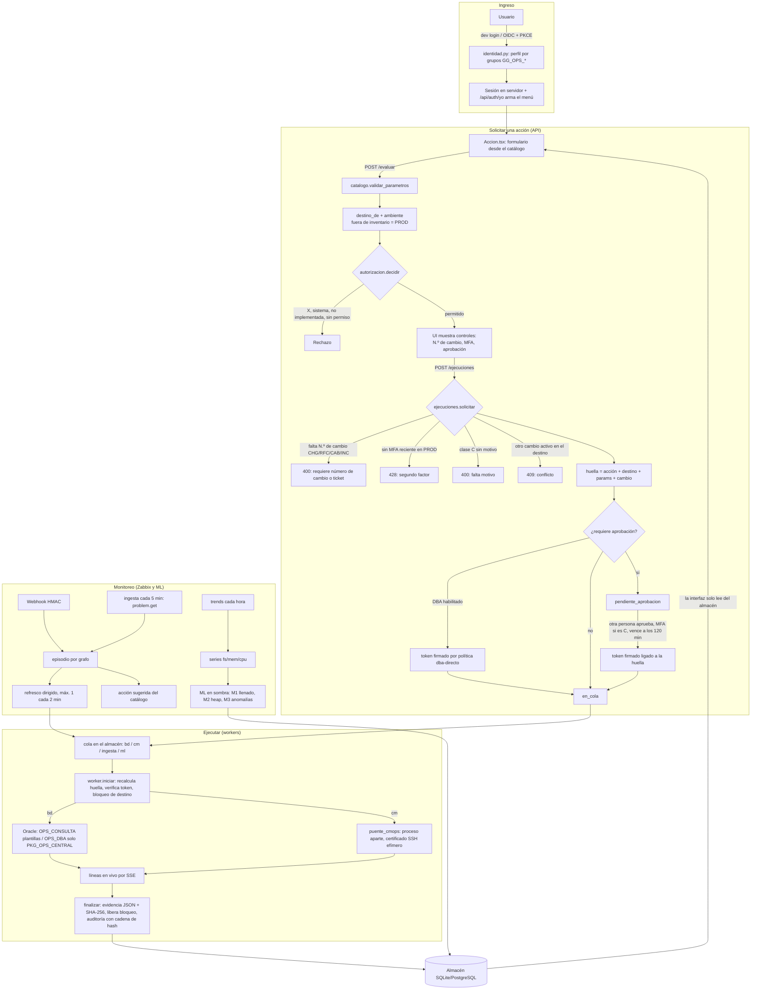

# Revisión del estado de Ops Central — 10/11/2026

## 1. Estado actual (verificado)

| Punto | Resultado |
|---|---|
| Pruebas backend | `python -m pytest -q`: **70 pasan**, 1 aviso (deprecación de `httpx` en el `TestClient` de Starlette) |
| Interfaz web | `tsc -b` sin errores; `dist/` compilado el 9/11 después del último cambio en `src/` |
| Catálogo | 101 acciones, **67 implementadas**, 34 catalogadas (ITSM, portal, ventana de cambio, IA) |
| Inventario generado | 211 servidores, 177 dominios, 182 bases, **0 relaciones dominio → base** |
| Pantallas | Todas operativas salvo **Ventana de cambios (E5)** e **Incidentes (E6)**, que muestran "próxima etapa" |
| Integraciones reales | Ninguna validada todavía: Oracle, cmops por SSH, SSO, Vault, PostgreSQL y Zabbix |
| Control de versiones | La carpeta **no es un repositorio git** |

## 2. Diagrama de flujo

## 3. Dependencia del "caso" (número de cambio / ticket): dónde está hoy

| # | Lugar | Qué exige hoy |
|---|---|---|
| 1 | `src/opscentral/autorizacion.py:72-76` | Clase O/C en PROD/DRP → `requiere_cambio = True` |
| 2 | `src/opscentral/autorizacion.py:84-86` + `catalogo/acciones.yaml` (`requiere_ticket` en `bd.usr.desbloquear` y `bd.usr.reset`) | Ticket obligatorio **en cualquier ambiente** |
| 3 | `src/opscentral/ejecuciones.py:103-107` | Rechaza si falta, y el formato solo acepta `CHG/RFC/CAB/INC + dígitos` |
| 4 | `src/opscentral/catalogo.py:23` y `:141-144` (tipo `cambio`) | Mismo formato cerrado para el parámetro de snapshots y recompilación |
| 5 | `catalogo/acciones.yaml`: `bd.snap.tomar`, `bd.snap.comparar`, `bd.inv.generar`, `bd.inv.recompilar` | Parámetro `cambio` obligatorio con ese formato |
| 6 | `apps/web/src/Accion.tsx:181-185`, `apps/web/src/pantallas.tsx:337, 355-360` | Campo "N.º de cambio o ticket (obligatorio)" y regex en la pantalla de snapshot |
| 7 | `capa-media-ops/cmops/trabajos.py:138-141` (no se modifica) | En PROD/DRP exige una referencia de 3 a 40 caracteres libres. **Si Ops Central deja de exigirla, las acciones de CM en PROD fallarían en cmops** |

## 4. Propuesta de cambio (pendiente de tu aprobación)

1. **"Referencia" opcional en lugar de "número de cambio"**. Formato libre de 3 a 40 caracteres (`[A-Za-z0-9_\-/.]`, igual que cmops), con un tipo opcional: incidente, cambio, requerimiento, problema, tarea, proactivo u otro.
2. **En PROD/DRP se mantienen**: el MFA, la aprobación de una segunda persona (clase C), la evidencia y la auditoría. El **motivo** pasa a ser obligatorio para O/C en PROD/DRP y reemplaza al número de cambio como justificación.
3. **Se quita `requiere_ticket`** del catálogo y de `autorizacion.py`. Las dos acciones afectadas siguen siendo clase C.
4. **Interruptor de configuración** `[aprobaciones] exigir_referencia_prod = false`, por si alguna política lo vuelve a pedir.
5. **Snapshots y recompilación**: el parámetro sigue siendo obligatorio porque empareja ANTES con DESPUÉS, pero acepta cualquier identificador (por ejemplo `DESPLIEGUE-NOMINA-1110`).
6. **Puente cmops**: si no hay referencia, se envía `OPS-<id de ejecución>` para cumplir la regla de cmops sin modificar cmops.
7. **Almacén**: se conserva la columna `cambio`, así no hace falta migración. La API acepta `referencia` y `cambio`, y la interfaz muestra "Referencia".
8. **Pruebas**: se ajustan `test_api.py:51-66`, `test_flujos_bd.py:67-68` y `test_catalogo_y_permisos.py:54`, y se agregan pruebas para: PROD sin referencia con motivo, PROD sin motivo (rechazo), referencia libre válida e inválida, y el valor de respaldo de cmops.

## 5. Lo que falta para poder hacer pruebas

### Bloqueantes (sin esto no se puede probar de punta a punta)
1. **Base Oracle de prueba**. No hay modo simulación: sin Oracle, toda acción `bd.*` falla en la interfaz. Opciones: una base TEST real, o un contenedor Oracle Free 23ai. Hay que instalar `db/oracle/01_pkg_ops_central.sql` y `02_cuentas_ops_central.sql`.
2. **Driver `oracledb`**. Está solo en el extra `prod`; con `pip install -e ".[dev]"` no se instala. Usar `pip install -e ".[dev,prod]"` o moverlo a un extra `pruebas`.
3. **`config/ops-central.toml` de pruebas**. No existe; hoy se carga el `.ejemplo.toml`. Debe apuntar a la base de prueba, al directorio de evidencia y al proveedor de secretos `archivo`.
4. **Secretos de prueba reales** en `config/secretos.dev.json` (o en un `secretos.pruebas.json` fuera del control de versiones) para `oracle/TEST/OPS_CONSULTA` y `oracle/TEST/OPS_DBA`. Hoy tienen valores ficticios.
5. **Servidor de Capa Media de TEST** con usuario `svc_opscentral`, llave o certificado SSH, `sudoers` acotado y comando forzado `ops-dispatch` (`deploy/capa-media/authorized_keys_y_sudoers.md`). Sin esto, las acciones `cm.*`, `orq.*` y `frm.*` no corren.

### Necesarios para cubrir todos los flujos
6. **`config/relaciones.json`** (dominio → base → datasource). Hoy hay 0 relaciones, y `cm.bd_relacionada` responde vacío.
7. **Zabbix de prueba**: token de solo lectura, secreto del webhook y el tipo de medio `deploy/zabbix/media_ops_central.js` cargado. Validar con `python -m opscentral zabbix-probar`.
8. **Bases que quedan por IP** en `oracle_map.yaml`, para que crucen con los hosts de Zabbix.
9. **Plan de pruebas de aceptación** de Ops Central, como el `capa-media-ops/docs/PRUEBA_INTEGRAL.md`. Por cada perfil (dba, cm, lid, con, adm): qué acción probar, en qué ambiente, el resultado esperado y la evidencia.
10. **Datos semilla para la interfaz**: un comando `python -m opscentral sembrar` que cargue ejecuciones, episodios y series de ejemplo en un almacén de pruebas. Hoy las pantallas se ven vacías hasta que algo corre.

### Calidad y automatización
11. **Pruebas de la interfaz**: no hay ninguna. Agregar Vitest para componentes (`Accion.tsx`, segundo factor) y Playwright para el flujo evaluar → confirmar → ejecutar → SSE.
12. **Repositorio git y CI** (pytest, `tsc -b`, build). Antes de versionar, sacar del control de versiones: `datos/` (ya ignorado), `capa-media-ops/evidencias/trabajos/*`, `capa-media-ops/config/CREDENCIALES_DEMO.txt` y `config/secretos.dev.json`.
13. **Aviso de `httpx`** en el `TestClient`: fijar las versiones de Starlette/httpx o migrar como indica el aviso.

## 6. Plan de mejoras (priorizado)

| Prioridad | Mejora | Motivo |
|---|---|---|
| P0 | Quitar la dependencia del caso (sección 4) | Lo pediste; hoy bloquea el trabajo proactivo y los requerimientos que no son incidentes ni cambios |
| P0 | Entorno de pruebas (sección 5, puntos 1 a 5) | Sin él no se valida nada de punta a punta |
| P1 | Git, CI y limpieza de artefactos con credenciales demo | Trazabilidad y evitar subir datos sensibles |
| P1 | Plan de pruebas de aceptación por perfil y datos semilla | Que QA y los equipos puedan probar sin el desarrollador |
| P1 | Verificar el cifrado de red de Oracle (el modo thin no soporta NNE: usar TCPS o thick) | Requisito de seguridad antes de ir a PROD |
| P2 | Pantalla de Incidentes (E6) por **caso genérico**: agrupar ejecuciones, episodios y evidencias por referencia, de cualquier tipo | Encaja con el nuevo modelo de referencia |
| P2 | Ventana de cambios (E5) y exportar evidencia por referencia (`com.evidencia.exportar`) | Hoy están catalogadas, no implementadas |
| P2 | Integración ITSM (`com.itsm.*`) reutilizando el MCP de Jira de `oracle-agent-kiro-master`, como **opcional**: enlazar la referencia si existe, sin exigirla | Mantiene la trazabilidad sin volverla obligatoria |
| P2 | Conectar Vault, PostgreSQL 16 y el SSO real (mapear GUID de grupos en Entra ID) | Pendientes 3 y 4 del README |
| P3 | Integrar `SqlPolicyEngine` del kit Oracle en vez de la política interna mínima | Pendiente 8 del README |
| P3 | Backfill de trends y backtest de M1 antes de sacar el ML de modo sombra | Pendiente 5 del README |
| P3 | Ampliar `SUGERENCIAS` de `zabbix/procesar.py` (hoy por palabra clave) a un mapeo configurable | Hoy está fijo en el código |
